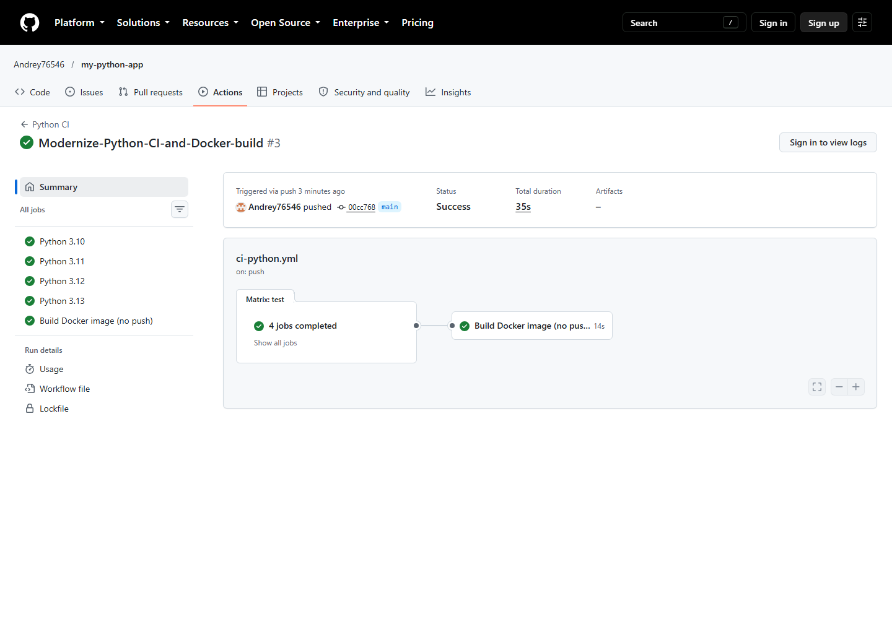

# Лабораторная работа 2. Python CI pipeline

## Цель работы

Настроить непрерывную интеграцию Python-приложения: проверку стиля, автоматические тесты в нескольких поддерживаемых версиях Python и сборку Docker-образа без публикации.

## Что сделано

- Workflow [`ci-python.yml`](.github/workflows/ci-python.yml) запускается для `push`, `pull_request` и вручную.
- Матрица проверяет Python `3.10`, `3.11`, `3.12` и `3.13` на `ubuntu-24.04`.
- Для каждой версии выполняются `flake8` и три теста `pytest`.
- После успешного завершения всей матрицы отдельная задача собирает Docker-образ.
- Docker job выполняется при любом поддерживаемом типе запуска и не пропускается из-за фильтра события.
- В Dockerfile используется Python `3.12-slim`; образ собирается только для проверки и не публикуется.

## Как запускать / проверять

Локальная проверка:

```bash
python -m pip install -r requirements.txt
python -m pip install -e .
flake8 myapp tests setup.py --count --max-line-length=127 --statistics
pytest tests/
docker build -t my-python-app:test .
docker run --rm my-python-app:test
```

В GitHub откройте вкладку **Actions** и выберите **Python CI**. Успешный запуск должен содержать четыре зелёные задачи матрицы и зелёную задачу **Build Docker image (no push)**.

## Результат выполнения

[Python CI #3](https://github.com/Andrey76546/my-python-app/actions/runs/39559416056) завершён со статусом **Success**: Python `3.10`–`3.13`, `flake8`, `pytest` и сборка Docker-образа прошли успешно (5 из 5 jobs).

## Скриншот



## Ссылка на workflow / Actions

- [Файл workflow](.github/workflows/ci-python.yml)
- [Все запуски Python CI](https://github.com/Andrey76546/my-python-app/actions/workflows/ci-python.yml)
- [Подтверждённый успешный запуск](https://github.com/Andrey76546/my-python-app/actions/runs/39559416056)
